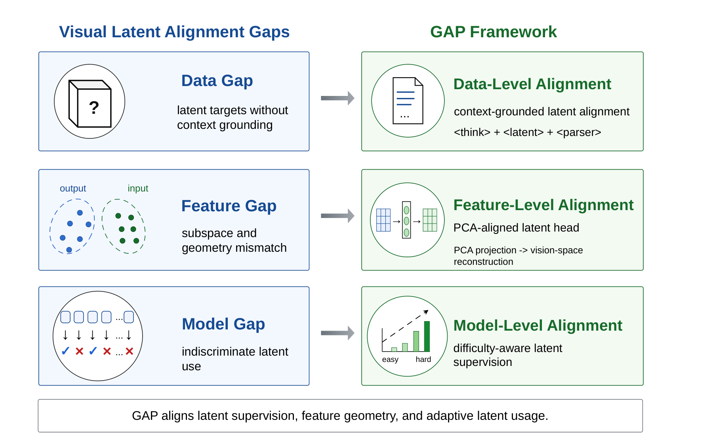
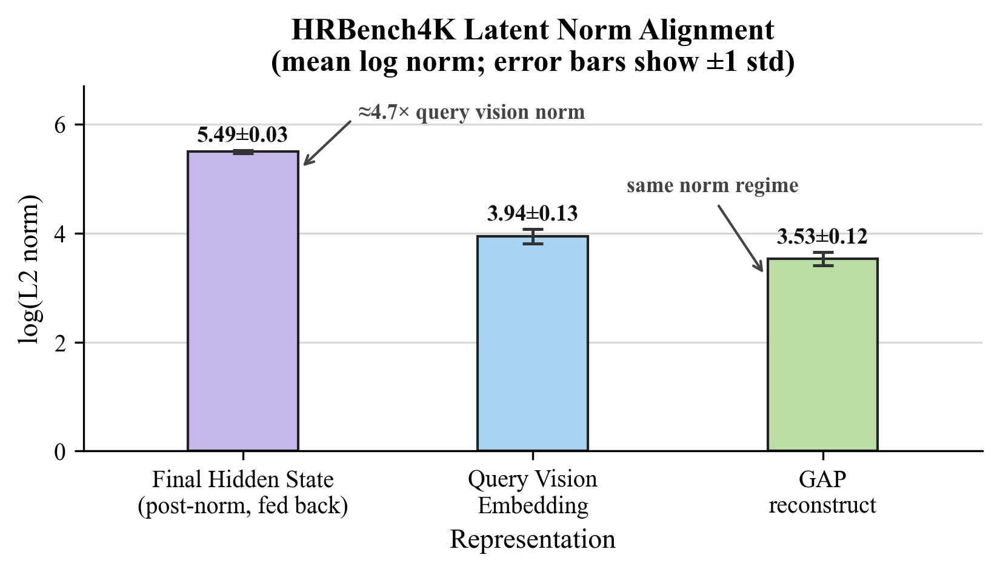
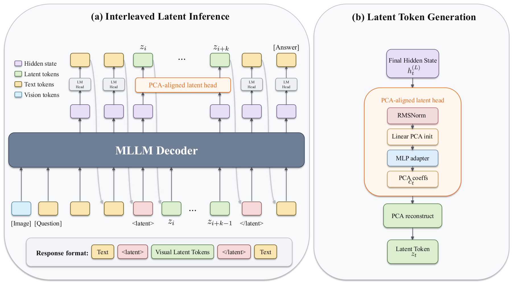

<div align="center">

# Fill the GAP

### A Granular Alignment Paradigm for Visual Reasoning in Multimodal Large Language Models

**NeurIPS 2026**

Yanting Miao<sup>\*1,2,4</sup>, Yutao Sun<sup>\*1,3</sup>, Dexin Wang<sup>1</sup>, Mengyu Zhou<sup>†1</sup>, Pascal Poupart<sup>2,4</sup>,<br>
Lei Lv<sup>1</sup>, Qi Zhao<sup>1</sup>, Li Wang<sup>1</sup>, Hao Li<sup>1</sup>, Xiaoxi Jiang<sup>1</sup>, Guanjun Jiang<sup>1</sup>

<sup>1</sup>Qwen Large Model Application Team, Alibaba &nbsp;·&nbsp; <sup>2</sup>University of Waterloo &nbsp;·&nbsp; <sup>3</sup>Zhejiang University &nbsp;·&nbsp; <sup>4</sup>Vector Institute<br>
<sub><sup>\*</sup>Work done during an internship at Alibaba. &nbsp; <sup>†</sup>Corresponding author.</sub>

<a href="https://openreview.net/forum?id=sITfxatJtF"></a>
<a href="https://huggingface.co/datasets/AlibabaQwenintern/gap-data"></a>
<a href="https://huggingface.co/Qwen/Qwen2.5-VL-7B-Instruct"></a>
<a href="LICENSE"></a>

</div>

<p align="center">
  
</p>

> **TL;DR.** Visual latent reasoning models feed the decoder's output state back as the next input. In Monet-7B, this fed-back state has **≈4.7×** the norm of the vision embeddings that the model was trained to read. **GAP** closes this gap at three levels (data, feature, model). On Qwen2.5-VL-7B, it is the only evaluated latent method that improves **both** perception (**+3.81** Avg-P) and reasoning (**+1.35** Avg-R) over the base model.

## 💡 Motivation

Visual latent reasoning lets a multimodal LLM create intermediate visual evidence as continuous tokens, without external tools or image generators. Most methods use an **output-as-input** loop: at each latent step, the decoder's final hidden state becomes the next input embedding. This loop assumes that output states live where input embeddings live.

They do not. Monet-7B feeds back the state after the final RMSNorm, and on HRBench4K this state is **≈4.7×** the norm of the query vision embeddings. The latents that GAP feeds back stay in the same norm regime as the vision embeddings.

<p align="center">
  
</p>

## 🧩 Method

GAP aligns visual latent reasoning at three levels:

| Level | Gap in output-as-input methods | GAP | In this repo |
|---|---|---|---|
| **Data** | Latent targets without context grounding | **Context-grounded latent supervision.** An auxiliary image at each latent position gives the latent an inspectable target (its frozen-ViT features). | `data/data_utils.py`, `image_types: "target"` |
| **Feature** | Decoder outputs and input embeddings differ in subspace and norm | **PCA-aligned latent head.** The head predicts PCA coefficients of the vision embeddings and reconstructs the latent in the input vision space. | `gap/modeling_gap.py`, `VISION_PCA_*_PATH` |
| **Model** | Latent supervision on every example | **Difficulty-aware assignment.** Only examples that the base model fails receive latent targets. | `accuracy` / `need_latent` fields |

<p align="center">
  
</p>

At inference, the model writes text, opens a `<latent>` segment, fills it with visual latent tokens from the PCA-aligned latent head (36 by default), closes it, and continues in text. Interleaved decoding is implemented in `GapForConditionalGeneration.generate_interleaved` ([`gap/modeling_gap.py`](gap/modeling_gap.py)).

## 📊 Main results

Qwen2.5-VL-7B backbone. **Bold** = best in each column.

| Method | HRBench4K | MMStar | MME-RW-Lite | **Avg-P** | MathVista | WeMath-S | WeMath-L | **Avg-R** |
|---|:-:|:-:|:-:|:-:|:-:|:-:|:-:|:-:|
| Qwen2.5-VL-7B | 68.13 | 60.46 | 44.39 | 57.66 | 68.50 | 36.29 | 53.06 | 52.62 |
| Dense Cap SFT | 69.38 | 60.50 | 47.73 | 59.20 | 67.70 | 28.60 | 45.43 | 47.24 |
| Monet-7B | 70.75 | 60.80 | 47.20 | 59.58 | 61.30 | 32.67 | 50.00 | 47.99 |
| LVR | 70.75 | 62.07 | **49.45** | 60.76 | 67.00 | 26.95 | 49.05 | 47.67 |
| LVR-49K | 71.63 | 62.17 | 48.78 | 60.86 | 68.82 | 30.59 | 49.65 | 49.69 |
| **GAP (ours)** | **73.25** | **63.40** | 47.77 | **61.47** | **71.00** | **36.33** | **54.57** | **53.97** |

<sub>HRBench4K, MMStar, and MME-RealWorld-Lite report Overall; Avg-P is their mean. WeMath is reported with strict (S) and loose (L) accuracy; Avg-R is the mean of MathVista, WeMath-S, and WeMath-L. LVR-49K is LVR trained with the same backbone and data as GAP.</sub>

- GAP is the only latent method that improves both aggregates over the base model. Monet-7B and LVR lose 4.6 and 5.0 Avg-R points.
- With the backbone and data fixed, GAP improves over LVR-49K by **+0.61** Avg-P and **+4.28** Avg-R.

See the paper for per-benchmark breakdowns, component ablations, and inference-time latent interventions.

## 🛠️ Installation

```bash
git clone https://github.com/Qwen-Applications/GAP.git
cd GAP
pip install -r requirements.txt
pip install -e .
```

> [!NOTE]
> GAP uses FlashAttention-2, so also install a `flash-attn` build that matches `torch==2.8.0`. `transformers` is pinned to 4.49.0 because 4.50+ causes generation repeats with Qwen2.5-VL-7B.

Download the base model:

```bash
hf download Qwen/Qwen2.5-VL-7B-Instruct --local-dir /root/model/Qwen2.5-VL-7B-Instruct
export MODEL_PATH=/root/model/Qwen2.5-VL-7B-Instruct
```

The package exposes the model as:

```python
from gap import GapConfig, GapForConditionalGeneration
```

GAP checkpoints use `model_type: gap` and the `GapForConditionalGeneration` architecture.

## 📦 Data

| Dataset | Size | Use |
|---|---|---|
| [**gap-data**](https://huggingface.co/datasets/AlibabaQwenintern/gap-data) | 36,985 examples (33,279 train / 3,706 val) + PCA basis | All results in the paper |
| [gap-p2-data](https://huggingface.co/datasets/AlibabaQwenintern/gap-p2-data) | 45,702 rows (41,996 train / 3,706 val) | Extended version for follow-up experiments |

The dataset cards describe sources, construction, fields, and licenses. Access is gated: log in to Hugging Face and accept the conditions on the dataset page, then download and extract:

```bash
hf auth login
hf download AlibabaQwenintern/gap-data --repo-type dataset --local-dir /root/data
cd /root/data
for f in images/*.tar; do tar -xf "$f" -C /root/data; done
```

With older versions of `huggingface_hub`, run `huggingface-cli download` with the same arguments. The archives take about 50 GB, and extraction needs roughly the same again; you can delete `images/*.tar` afterwards.

After extraction, `/root/data` matches the launcher defaults:

```text
/root/data/
├── train.jsonl        # TRAIN_DATA_PATH, TRAIN_META_FILEPATHS
├── val.jsonl          # VAL_DATA_PATH
├── vit_pca_mu.npy     # VISION_PCA_MU_PATH
├── vit_pca_W.npy      # VISION_PCA_W_PATH
├── monet/
├── chart/
├── GEOQA/
├── MM_MATH/
├── MATHVISION/
└── geo3k_train/
```

Image paths in the JSONL files are either absolute (`/root/data/...`) or relative to `/root/data`, which is the image root for every `data_source` in the default `IMAGE_ROOTS` of `scripts/run_train.sh`. To keep the data elsewhere, rewrite the `/root/data/` prefix in the JSONL files and set `IMAGE_ROOTS` to your root.

<details>
<summary><b>Data format</b></summary>

<br>

Training data is JSONL. Each line contains `messages` or `message` with role/dialog fields. Images are referenced by `image_filenames`, and `image_types` separates query images (`input`) from auxiliary target images (`target`):

```json
{
  "data_source": "monet_Visual_CoT",
  "accuracy": 0.0,
  "messages": [
    {
      "role": "user",
      "dialog": "Question text <|vision_start|><|image_pad|><|vision_end|>",
      "image_filenames": ["query.jpg"],
      "image_types": ["input"]
    },
    {
      "role": "assistant",
      "dialog": "Reasoning <|vision_start|><|image_pad|><|vision_end|> final answer",
      "image_filenames": ["auxiliary.jpg"],
      "image_types": ["target"]
    }
  ]
}
```

The image placeholder in the assistant turn marks where the visual latent goes; during training it becomes `<|latent_start|>`, `LATENT_SEQ_LEN` latent pad tokens, and `<|latent_end|>`.

Difficulty-aware assignment uses `accuracy`: examples with `accuracy > ACC_THRESHOLD` are treated as easy and lose their auxiliary latent targets. In gap-data this assignment is already applied: only examples that the base model never solved (`accuracy` 0, `need_latent: true`) carry auxiliary images.

</details>

## 🚀 Training

**1. (Optional) Export a PCA basis.** gap-data ships the basis used in the paper (629 components, 95% retained variance, fit on the training split), so you can skip this step. To fit your own basis on target auxiliary-image embeddings:

```bash
MODEL_NAME_OR_PATH=/root/model/Qwen2.5-VL-7B-Instruct \
TRAIN_META_FILEPATHS=/root/data/train.jsonl \
OUTPUT_DIR=/root/output/gap_pca \
bash scripts/run_export_vit_pca.sh
```

**2. Train GAP.**

```bash
export WORLD_SIZE=1 RANK=0 MASTER_ADDR=127.0.0.1 MASTER_PORT=29500
export NPROC_PER_NODE=8

export MODEL_PATH=/root/model/Qwen2.5-VL-7B-Instruct
export TRAIN_DATA_PATH=/root/data/train.jsonl
export VAL_DATA_PATH=/root/data/val.jsonl
export VISION_PCA_MU_PATH=/root/data/vit_pca_mu.npy
export VISION_PCA_W_PATH=/root/data/vit_pca_W.npy
export PRIMUS_SAVE_CHECKPOINT_DIR=/root/output/gap_stage1_train
export PRIMUS_TENSORBOARD_LOG_DIR=/root/output/gap_stage1_logs

bash scripts/run_train.sh
```

> [!IMPORTANT]
> Set `VISION_PCA_MU_PATH` and `VISION_PCA_W_PATH`. The launcher leaves them empty by default, and without them the model trains an unconstrained latent head with no PCA alignment.

Main defaults in `scripts/run_train.sh`:

| Variable | Default | Meaning |
|---|---|---|
| `LATENT_SEQ_LEN` | `36` | Latent tokens per latent segment (must be a perfect square) |
| `VISION_HEAD_MODE` | `linear` | Latent head type |
| `GLOBAL_BATCH_SIZE` | `128` | Global batch size |
| `LR` / `VISION_LR` | `1e-5` / `1e-5` | Learning rates of the model and the latent head |
| `EPOCHS` | `2` | Training epochs |
| `LATENT_LOSS_WEIGHT` | `1.0` | Weight of the latent reconstruction loss |
| `ACC_THRESHOLD` | `0.0` | Difficulty-aware threshold (see [Data format](#-data)) |

For a small smoke run:

```bash
export NPROC_PER_NODE=1
bash scripts/debug_stage1_train.sh
```

All machine-specific paths are environment variables. The `/root/...` defaults are placeholders for a container or cluster setup.

## 🔬 Ablations

| Ablation | How |
|---|---|
| No PCA alignment (unconstrained latent head) | Leave `VISION_PCA_MU_PATH` and `VISION_PCA_W_PATH` unset |
| Text-only SFT on the same data (no latent tokens) | `NO_LATENT=true bash scripts/run_train.sh` |
| Keep latent tokens, remove the latent loss | `NO_LATENT_LOSS=true bash scripts/run_train.sh` |
| Latent-token budget | `LATENT_SEQ_LEN=16 bash scripts/run_train.sh` (e.g. 4, 16, 36, 64, 144) |

<details>
<summary><b>Sanity checks and diagnostics</b></summary>

<br>

Import checks:

```bash
python -c "from gap import GapConfig, GapForConditionalGeneration; print(GapConfig.model_type)"
python -c "from data.data_utils import InterleaveDataset, InterleaveDataCollator; print('ok')"
```

Query-image resolutions in a training JSONL:

```bash
python -m scripts.stats_resolution \
  --model_name_or_path /root/model/Qwen2.5-VL-7B-Instruct \
  --train_meta_filepath /root/data/train.jsonl \
  --image_root_dirs '{"monet_Visual_CoT": "/root/data"}' \
  --latent_seq_len 36 \
  --num_samples 5000
```

</details>

## 📁 Repository layout

```text
GAP/
├── gap/                       # GapConfig and GapForConditionalGeneration (PCA-aligned latent head)
├── training/train.py          # training entry point
├── data/
│   ├── data_utils.py          # interleaved text/image/latent dataset and collator
│   ├── prepare_*.py           # per-source data preparation
│   ├── re_infer.py            # teacher re-inference (see data/re_infer_README.md)
│   └── verify_answer.py       # answer verification
├── analyze/
│   ├── export_vit_pca.py      # PCA basis of auxiliary-image vision embeddings
│   └── vis_latent.py          # latent visualization (PCA / t-SNE)
├── scripts/
│   ├── run_train.sh           # main distributed training launcher
│   ├── debug_stage1_train.sh  # small launcher for smoke runs
│   ├── run_export_vit_pca.sh  # PCA export launcher
│   └── ...                    # re-inference, answer verification, vLLM server, statistics
├── deepspeed/                 # DeepSpeed configs
└── inference/PLAN.md          # design notes for a vLLM inference path
```

## 📝 Citation

If you find GAP useful, please cite:

```bibtex
@inproceedings{miao2026gap,
  title     = {Fill the {GAP}: A Granular Alignment Paradigm for Visual Reasoning in Multimodal Large Language Models},
  author    = {Miao, Yanting and Sun, Yutao and Wang, Dexin and Zhou, Mengyu and Poupart, Pascal and Lv, Lei and Zhao, Qi and Wang, Li and Li, Hao and Jiang, Xiaoxi and Jiang, Guanjun},
  booktitle = {Advances in Neural Information Processing Systems},
  year      = {2026}
}
```

## 📄 License

The code is released under the [MIT License](LICENSE). Our additions to the training data are released under [CC BY-NC 4.0](https://creativecommons.org/licenses/by-nc/4.0/); the source datasets keep their own licenses, listed on the [dataset card](https://huggingface.co/datasets/AlibabaQwenintern/gap-data).

## 🙏 Acknowledgements

GAP builds on [Qwen2.5-VL](https://github.com/QwenLM/Qwen2.5-VL). Part of the training data comes from Monet's released data and other public datasets; see the dataset card for all sources.
